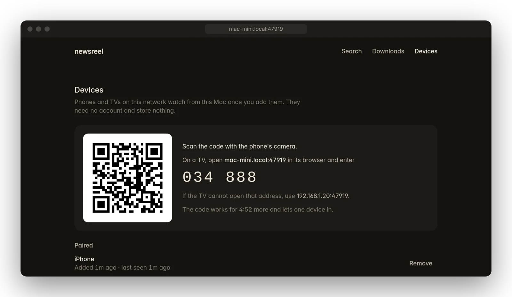

<h1 align="center">torrential</h1>

<p align="center">Find films and shows on Usenet, and watch them on your Mac, phone, or TV while they download.</p>

<p align="center">A fork of <a href="https://github.com/nexxeln/torrential">nexxeln/torrential</a> that downloads from NNTP servers instead of BitTorrent. See <a href="docs/usenet-conversion.md">docs/usenet-conversion.md</a>.</p>

<p align="center">
  
  
</p>

## Install

This fork has no published releases, so it does not update itself. Build it with Rust, a C compiler, and [bun](https://bun.sh) (for the web app):

```sh
cargo install --path crates/torrential
```

Or, with Nix and flakes turned on, `nix develop -c cargo install --path crates/torrential`.

Then add your indexer and Usenet servers to `~/.config/torrential/config.yaml`:

```yaml
sources:
  newznab:                      # NZBHydra, Prowlarr, or an indexer's own API
    - name: hydra
      url: http://127.0.0.1:5076/api
      api_key_env: HYDRA_API_KEY
usenet:
  servers:
    - host: news.example.com    # TLS on port 563 unless you say otherwise
      username: you
      password_env: NEWS_PASSWORD
      connections: 20
    - host: backup.example.com
      username: you
      password_env: BACKUP_PASSWORD
      priority: 1               # asked only for articles the servers above lack
```

Keys and passwords come from the environment variables you name, never from the file.

The engine starts at login and keeps running, so your phone and TV can always reach it. It carries on its downloads after a restart. To stop it starting at login, run `torrential engine uninstall`.

## Run it on a server

On a Linux server, NAS, or seedbox, install with `--server`:

```sh
curl -fsSL https://raw.githubusercontent.com/nexxeln/torrential/main/install.sh | sh -s -- --server
```

The engine then starts when the machine boots, with no one logged in, and listens on the network. The command ends with a QR code and a link that pair your first phone or computer. Paired devices reach the server from any network, and anyone else gets only the pairing page. `torrential server uninstall` turns this off.

Or run it in Docker, for amd64 and arm64. It needs the host's network to name its address in the pairing link and to find TVs, and it keeps settings, state and downloads in `/data`:

```sh
mkdir -p ~/torrential
docker run -d --name torrential --network host --restart unless-stopped \
  --user "$(id -u):$(id -g)" -v ~/torrential:/data ghcr.io/nexxeln/torrential
docker exec torrential torrential devices add
```

Templates for [Unraid](docker/unraid/torrential.xml) and [TrueNAS](docker/truenas/torrential.yaml) set the same up. A newer image updates it. Its config file is `/data/config/config.yaml`.

To watch away from home, install [Tailscale](https://tailscale.com) on the server and on your devices. The pairing link and QR code then use the server's tailnet name, which works from any network with no port opened. With a domain of your own, put [Caddy](https://caddyserver.com) in front, which gets the HTTPS certificate, and set `public_address` in the config file so pairing links use it:

```
tv.example.com {
	reverse_proxy 127.0.0.1:47919
}
```

## Watch on the Mac

```sh
torrential web
```

Search by name. Each film or show is one card, not a list of releases. Press Play. torrential picks the release that suits your language and the screen you watch on, and moves to the next one if it does not start. Jump anywhere and torrential fetches the articles under that part first. While you watch, the film gets the bandwidth before other downloads.

Releases stored in RAR volumes play without extracting; compressed or password-protected ones are skipped with a reason.

What you play goes to a folder that only torrential uses, capped at 20 GiB. When it fills, torrential deletes the plays you watched longest ago, but never the film you watched last or a title you saved. When you remove a download you started yourself, its files go to the Trash.

torrential converts MKV files and surround sound for the browser with [ffmpeg](https://ffmpeg.org), and fetches ffmpeg the first time a file needs it.

## Add a phone or a TV

<p align="center">
  
</p>

On the Mac, open **Devices** and choose **Add a device**, or run `torrential devices add`. On a phone, scan the QR code. On a TV, open the address in its browser and enter the code. The device needs no account and stores nothing. The web app works with a touch screen and with a TV remote. A device you did not add sees the pairing page and nothing else.

## Play on TV

<p align="center">
  
</p>

LG, Samsung, Sony, and most other smart TVs play over DLNA. On a title page, on the Mac or a phone you added, choose **Play on TV** and pick the TV. The phone then works as the remote. torrential sends the TV only copies in a format it plays.

```sh
torrential tv                    # list the TVs on the home network
torrential tv play tt0063350     # play a film on the TV
torrential tv seek 1:02:30       # or pause, resume, volume, and stop
```

## In your terminal

Run `torrential` to open the terminal UI on what you were watching and the titles you saved. Press `/` to find a film or a show, and Enter to open or play it in IINA, mpv, or VLC. Press `d` to see your downloads.

Or run the commands yourself:

```sh
torrential titles night of the living dead   # find a film or a show
torrential play tt0063350                    # watch it in IINA, mpv, or VLC
torrential play tt1748166 s01e02             # or one episode
torrential get tt0063350                     # download it to keep

torrential search sintel 2010                # or search the indexers
torrential get ufd69b2 --files '*.mkv'       # and download only the files you want
torrential get ~/Downloads/film.nzb          # or an NZB file or URL
torrential status                            # list your downloads
```

`torrential --help` lists the rest. Every command takes `--json`.

## More indexers

To add an indexer, give torrential its Newznab API address and key, or the address of [Prowlarr](https://prowlarr.com) to add every Usenet indexer you set up there:

```sh
torrential indexers add https://api.nzbgeek.info/api --key <api key> --name geek
torrential indexers add http://localhost:9696 --key <api key>   # adds every Usenet indexer in Prowlarr
torrential indexers                                             # whether each answers, and what it carries
```

Search, titles and Play use them at once, also when the engine runs on a server. The key is kept in `config.yaml`, which only you can read.

## With your agent

```sh
torrential skill install
```

The skill teaches Claude Code, Codex, Gemini CLI, Cursor, and other agents to use torrential. Then ask in plain words, such as "play Night of the Living Dead on the TV" or "download Sintel in 1080p".

## Settings

`torrential setup` shows the screen and language torrential found on the Mac and lets you change them. Results are ranked for your screen, CPU, and language. Releases from groups that [TRaSH Guides](https://trash-guides.info) ranks come first, and ones it lists to avoid are marked `avoid` and come last. Film and show details come from Cinemeta and IMDb. Set everything else in `~/.config/torrential/config.yaml`, with the indexers and servers above:

```yaml
downloads:
  dir: ~/Downloads/films      # default: a torrential folder in Downloads
plays:
  max: 50GiB                  # what plays may take up, default 20GiB
player: mpv                   # for torrential play: iina, mpv, vlc, or a path
subtitles:
  online: false               # do not look for subtitles online
catalog:
  online: false               # do not look up films and shows online
ffmpeg:
  fetch: false                # do not fetch ffmpeg when it is not installed
updates: notify               # say when a new version is out instead of installing it, or off
public_address: https://tv.example.com  # the address pairing links use, such as a domain in front of a server
```

## Only what you have the right to

torrential only downloads, and checks each article's CRC32 as it lands. Download only what you have the right to.

## License

MIT. See [LICENSE](LICENSE).

The release group lists are from [TRaSH Guides](https://github.com/TRaSH-Guides/Guides), MIT, bundled at one commit in [crates/search/src/trash](crates/search/src/trash) with their license. `python3 -I scripts/trash/update.py` refreshes them.
