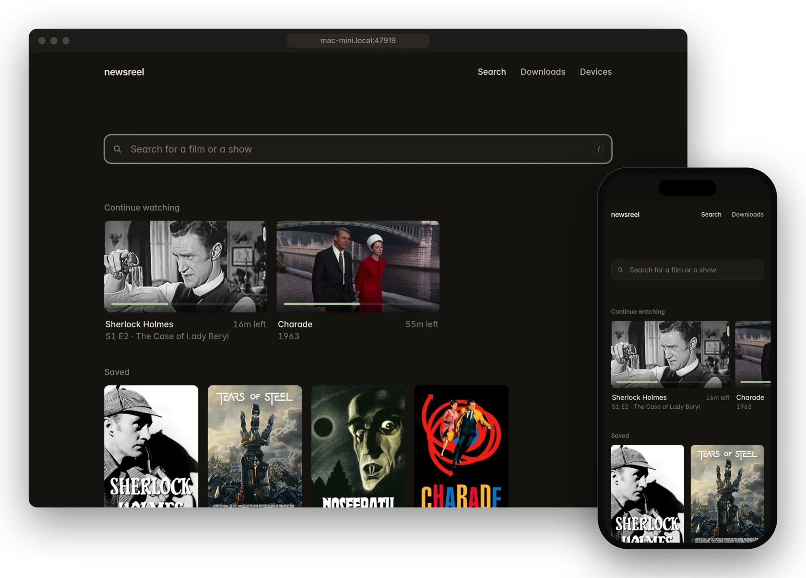

<h1 align="center">newsreel</h1>

<p align="center">Find films and shows on Usenet, and watch them on your Mac, phone, or TV while they download.</p>

<p align="center">A fork of <a href="https://github.com/nexxeln/torrential">nexxeln/torrential</a> that downloads from NNTP servers instead of BitTorrent. See <a href="docs/usenet-conversion.md">docs/usenet-conversion.md</a>.</p>

<p align="center">
  
  
</p>

## Install

This fork has no published releases, so it does not update itself. Build it with Rust, a C compiler, and [bun](https://bun.sh) (for the web app):

```sh
cargo install --path crates/newsreel
```

Or, with Nix and flakes turned on, `nix develop -c cargo install --path crates/newsreel`.

Then add your indexer and Usenet servers to `~/.config/newsreel/config.yaml`:

```yaml
sources:
  newznab:                      # NZBHydra, Prowlarr, or an indexer's own API
    - name: hydra
      url: http://127.0.0.1:5076/api
      api_key_env: HYDRA_API_KEY
usenet:
  servers:
    - host: news.example.com    # TLS on port 563 unless you say otherwise
      username: you
      password_env: NEWS_PASSWORD
      connections: 20
    - host: backup.example.com
      username: you
      password_env: BACKUP_PASSWORD
      priority: 1               # asked only for articles the servers above lack
```

Keys and passwords come from the environment variables you name, never from the file.

The engine starts at login and keeps running, so your phone and TV can always reach it. It carries on its downloads after a restart. To stop it starting at login, run `newsreel engine uninstall`.

## Watch on the Mac

```sh
newsreel web
```

Search by name. Each film or show is one card, not a list of releases. Press Play. newsreel picks the release that suits your language and the screen you watch on, and moves to the next one if it does not start. Jump anywhere and newsreel fetches the articles under that part first. While you watch, the film gets the bandwidth before other downloads.

Releases stored in RAR volumes play without extracting; compressed or password-protected ones are skipped with a reason.

What you play goes to a folder that only newsreel uses, capped at 20 GiB. When it fills, newsreel deletes the plays you watched longest ago, but never the film you watched last or a title you saved. When you remove a download you started yourself, its files go to the Trash.

newsreel converts MKV files and surround sound for the browser with [ffmpeg](https://ffmpeg.org), and fetches ffmpeg the first time a file needs it.

## Add a phone or a TV

<p align="center">
  
</p>

On the Mac, open **Devices** and choose **Add a device**, or run `newsreel devices add`. On a phone, scan the QR code. On a TV, open the address in its browser and enter the code. The device needs no account and stores nothing. The web app works with a touch screen and with a TV remote. A device you did not add sees the pairing page and nothing else.

## Play on TV

<p align="center">
  
</p>

LG, Samsung, Sony, and most other smart TVs play over DLNA. On a title page, on the Mac or a phone you added, choose **Play on TV** and pick the TV. The phone then works as the remote. newsreel sends the TV only copies in a format it plays.

```sh
newsreel tv                    # list the TVs on the home network
newsreel tv play tt0063350     # play a film on the TV
newsreel tv seek 1:02:30       # or pause, resume, volume, and stop
```

## In your terminal

Run `newsreel` to open the terminal UI on what you were watching and the titles you saved. Press `/` to find a film or a show, and Enter to open or play it in IINA, mpv, or VLC. Press `d` to see your downloads.

Or run the commands yourself:

```sh
newsreel titles night of the living dead   # find a film or a show
newsreel play tt0063350                    # watch it in IINA, mpv, or VLC
newsreel play tt1748166 s01e02             # or one episode
newsreel get tt0063350                     # download it to keep

newsreel search sintel 2010                # or search the indexers
newsreel get ufd69b2 --files '*.mkv'       # and download only the files you want
newsreel get ~/Downloads/film.nzb          # or an NZB file or URL
newsreel status                            # list your downloads
```

`newsreel --help` lists the rest. Every command takes `--json`.

## With your agent

```sh
newsreel skill install
```

The skill teaches Claude Code, Codex, Gemini CLI, Cursor, and other agents to use newsreel. Then ask in plain words, such as "play Night of the Living Dead on the TV" or "download Sintel in 1080p".

## Settings

`newsreel setup` shows the screen and language newsreel found on the Mac and lets you change them. Results are ranked for your screen, CPU, and language. Releases from groups that [TRaSH Guides](https://trash-guides.info) ranks come first, and ones it lists to avoid are marked `avoid` and come last. Film and show details come from Cinemeta and IMDb. Set everything else in `~/.config/newsreel/config.yaml`, with the indexers and servers above:

```yaml
downloads:
  dir: ~/Downloads/films      # default: a newsreel folder in Downloads
plays:
  max: 50GiB                  # what plays may take up, default 20GiB
player: mpv                   # for newsreel play: iina, mpv, vlc, or a path
subtitles:
  online: false               # do not look for subtitles online
catalog:
  online: false               # do not look up films and shows online
ffmpeg:
  fetch: false                # do not fetch ffmpeg when it is not installed
```

## Only what you have the right to

newsreel only downloads, and checks each article's CRC32 as it lands. Download only what you have the right to.

## License

MIT. See [LICENSE](LICENSE).

The release group lists are from [TRaSH Guides](https://github.com/TRaSH-Guides/Guides), MIT, bundled at one commit in [crates/search/src/trash](crates/search/src/trash) with their license. `python3 -I scripts/trash/update.py` refreshes them.
